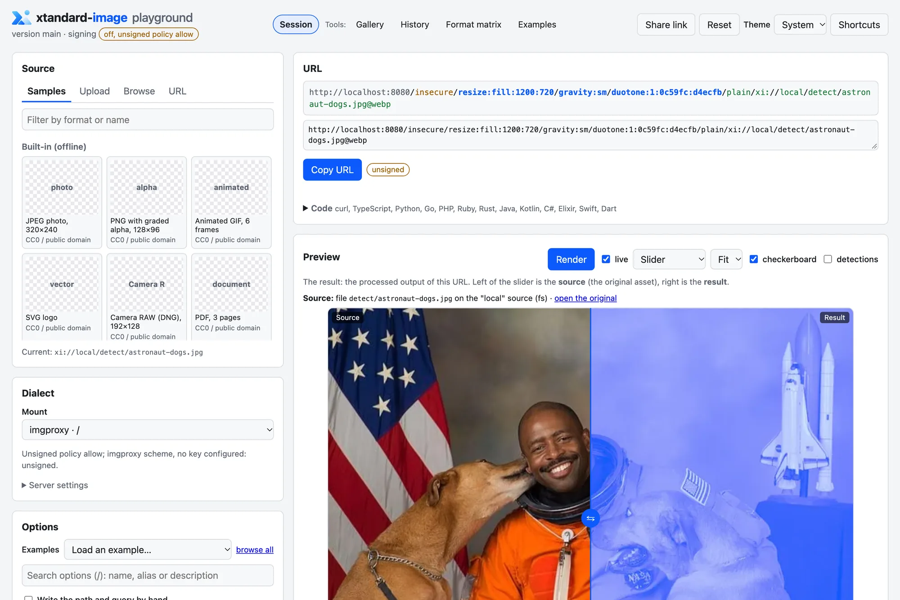

<p align="center">
  <picture>
    <source media="(prefers-color-scheme: dark)" srcset="docs/assets/lockup-horizontal-dark.png">
    <source media="(prefers-color-scheme: light)" srcset="docs/assets/lockup-horizontal-light.png">
    
  </picture>
</p>

<div align="center">

<p><strong>A self-hosted image and video processing server in Go and libvips.</strong><br/>
imgproxy-compatible URLs, plus the URL dialects of imgix, Cloudinary, ImageKit, Cloudflare, Thumbor and more. MIT licensed.</p>

<p>
  <a href="https://github.com/xantiagoma/xtandard-image/releases"></a>
  <a href="https://github.com/xantiagoma/xtandard-image/pkgs/container/xtandard-image"></a>
  <a href="https://github.com/xantiagoma/xtandard-image/blob/main/LICENSE"></a>
  <a href="https://0ver.org"></a>
  <a href="https://github.com/xantiagoma/xtandard-image/actions/workflows/ci.yml"></a>
</p>

</div>

xtandard-image is an open-source media server meant to cover everything your application does with images, and more and more with video: resize, crop, convert, optimise, watermark, detect, transcode and stream, on the fly, from a URL. Point it at your storage (http origins, S3 and compatible stores, GCS, Azure Blob, local directories, FTP and SFTP), put a CDN in front, and ask for what you need in the URL. It ships as ready-to-run Docker images, with nothing to compile.

<p align="center">
  <a href="docs/PLAYGROUND.md">
    <picture>
      <source media="(prefers-color-scheme: dark)" srcset="docs/assets/playground-dark.webp">
      <source media="(prefers-color-scheme: light)" srcset="docs/assets/playground-light.webp">
      
    </picture>
  </a>
  <br/><sub>The built-in <a href="docs/PLAYGROUND.md">playground</a>: build a URL in any dialect and compare the source with the result.</sub>
</p>

## Quick start

Start a server that may fetch only from `images.unsplash.com`, with the Cloudflare Images URL format enabled next to the imgproxy one:

```sh quickstart
docker run -d --name xtandard-image -p 8080:8080 \
  -e XI_SOURCES=web -e XI_SOURCES_WEB_TYPE=http -e XI_SOURCES_WEB_ALLOW=images.unsplash.com \
  -e XI_DIALECTS_CLOUDFLARE_ENABLED=true \
  ghcr.io/xantiagoma/xtandard-image:0.1.0
until curl -fsS http://localhost:8080/healthz >/dev/null; do sleep 1; done

# imgproxy URL: fit into 640 px wide, as WebP
curl -fsS -o thumb.webp \
  'http://localhost:8080/insecure/rs:fit:640:0/plain/https://images.unsplash.com/photo-1506744038136-46273834b3fb@webp'

# Cloudflare Images URL: a 640x384 crop, as AVIF
curl -fsS -o crop.avif \
  'http://localhost:8080/cdn-cgi/image/width=640,height=384,fit=cover,format=avif/https://images.unsplash.com/photo-1506744038136-46273834b3fb'

docker rm -f xtandard-image
```

Without signing keys, unsigned URLs are accepted only with common widths, heights and qualities (the `restricted` policy: 640, 750, 828, 1080, 1200 and so on; the server logs the list at startup). Any other size, and any host outside the allowlist, gets a 403. For production, add signing keys: [Getting started](docs/GETTING-STARTED.md) walks through signed URLs, `/info` and a Compose service for Dokploy or Coolify.

The images are public on GHCR; you can also [build the image](docs/GETTING-STARTED.md#1-get-the-image) from a clone.

## Why it exists

Hosted image services such as imgix, Cloudinary, ImageKit and Cloudflare Images, and servers such as imgproxy and thumbor, shaped how media is served on the web, and xtandard-image learned a lot from them. Many of their most useful features, though, sit behind paid plans or inside proprietary platforms. xtandard-image started as a tool for its author's own projects, and its goal is to cover all of an application's media needs in one fully open-source server that you run yourself: its code is MIT licensed, with no paid tier and no features held back.

That is possible because it stands on excellent open-source software: [libvips](https://www.libvips.org/) for images, [FFmpeg](https://ffmpeg.org/) for video and audio, LibRaw, PDFium, ONNX Runtime and many more. Each image lists them, with their licences, in `/opt/xtandard/share/licenses/`, and [NOTICE](NOTICE) credits the open-source work the repository builds on.

It also speaks the URL formats of the services that inspired it, so you can move to it without rewriting your front end. Those compatibility layers follow each service's public URL API and documentation. The server has its own code and design; the few parts derived from other open-source projects keep their licences and are credited in [NOTICE](NOTICE). xtandard-image is an independent project, not affiliated with any of the services it is compatible with ([disclaimer](#disclaimer)).

## Features

- **imgproxy URLs work unchanged.** That includes signing, `enc/` encrypted sources, presets, chained pipelines, `/info` and every processing option, including the ones imgproxy offers only in its Pro edition.
- **Many URL dialects.** Besides imgproxy, it serves imgix, Cloudinary, ImageKit, Cloudflare Images, Bunny, Thumbor, wsrv/weserv, AWS Serverless Image Handler, a query-string form with imaginary's endpoints, and the other [unpic](https://unpic.pics/providers/) providers. An unpic `<Image>` set up for one of those CDNs can point at xtandard-image and keep its code.
- **A long list of formats.** It reads JPEG, PNG, GIF, WebP, AVIF, HEIC, JPEG XL, TIFF, SVG, JPEG 2000 and UltraHDR, camera RAW, PDF, PSD, HDR formats, designer files and dozens of legacy formats. It writes JPEG, PNG, GIF, WebP, AVIF, JPEG XL, TIFF, BMP and ICO ([FORMATS](docs/FORMATS.md)).
- **Video and audio** (`full` and `gpl` images): thumbnails, sprites, GIF to video, transcoding with trim, resize, overlays and audio processing, and HLS/DASH streams.
- **Detection:** face and object detection for smart crops, blurring and `/info`, plus image classification, on the CPU (`full` and `gpl` images).
- **Secure by default.** The server refuses to start without a source allowlist. It protects against SSRF, DNS rebinding included, enforces decompression-bomb and pixel limits, and sanitises SVG.
- **CDN-friendly and stateless.** It sends correct `Cache-Control`, `ETag`, `Vary` and `Content-DPR` headers, answers 304 before any processing, coalesces requests for the same original, and has an optional memory, disk, S3 or Redis result cache.
- **Easy to operate.** It exposes Prometheus metrics and OpenTelemetry tracing, and has health and readiness endpoints, admission control (429/503), a read-only multi-arch image, and a Helm chart.

[docs/COMPARISON.md](docs/COMPARISON.md) compares it with imgproxy (OSS and Pro), thumbor, imaginary and weserv, feature by feature. [bench/RESULTS.md](bench/RESULTS.md) compares its speed with imgproxy OSS.

## Image flavours

| Flavour | Adds | Licences |
|---|---|---|
| `slim` | every still image format | no GPL code |
| `full` | `slim` + FFmpeg (video decode, VP9 and AV1 encode) + ONNX Runtime with face, object and classification models | no GPL code |
| `gpl` | `full` + H.264 and HEVC encoding, and EPS/PostScript through sandboxed Ghostscript (off by default) | **contains GPL and AGPL software** |

Each flavour is a linux/amd64 and linux/arm64 image at `ghcr.io/xantiagoma/xtandard-image`, tagged `<version>-<flavour>`. Every push to `main` also publishes signed development images, `main-<flavour>` and an immutable `sha-<commit>-<flavour>` per commit ([edge images](docs/RELEASE.md#edge-images)); `latest` stays on the newest stable release. If you run or redistribute `gpl`, checking that its licences and the H.264/HEVC patents work for you is your job; if unsure, use `full`. The xtandard-image code itself is MIT. See [Getting started](docs/GETTING-STARTED.md#choose-a-flavour) for the details, and [ADR 0006](docs/adr/0006-license-policy.md) for the licence policy.

## Usage

- **URL dialects:** the grammar, option mapping and signing of every format: [URL-DIALECTS](docs/URL-DIALECTS.md).
- **Configuration:** `XI_*` environment variables, or a YAML, JSON or TOML file with a JSON Schema that gives you editor completion. `XI_COMPAT_IMGPROXY_ENV=true` accepts your existing `IMGPROXY_*` variables: [CONFIG](docs/CONFIG.md).
- **Sources:** you can configure several S3-compatible stores, GCS, Azure, directories, FTP/SFTP servers and http origins at once, each with its own allowlist and credentials: [SOURCES](docs/SOURCES.md).
- **Signing and encryption:** imgproxy HMAC signatures, `xi_sig` for the other dialects, each CDN's own signing scheme, and AES `enc/` sources: [URL-DIALECTS §2](docs/URL-DIALECTS.md#2-signing-schemes-at-a-glance).
- **Video and audio:** `/video` and `/q/video` transformations and HLS/DASH streams, in the `full` and `gpl` images: [URL-DIALECTS §3.8](docs/URL-DIALECTS.md#38-video-transformations-wp-122-wp-123).
- **HTTP API:** an OpenAPI 3.1 document, served on the admin listener and printed by `xtandard-image openapi`: [OPENAPI](docs/OPENAPI.md).
- **Playground:** a web UI to build URLs in every dialect, compare source and result, and copy the code for any client. It is built into the binary and off by default: [PLAYGROUND](docs/PLAYGROUND.md).

### Clients

Each official client builds and signs URLs for this server, encrypts sources, and calls `/info` and the health endpoints. They are all generated from one spec and share one conformance fixture ([clients/README](clients/README.md)). None is on a package registry yet. Each client's version is the server's version.

| Language | Directory | Package |
|---|---|---|
| TypeScript | [`clients/typescript`](clients/typescript/README.md) | npm `@xtandard/image` |
| Python | [`clients/python`](clients/python/README.md) | PyPI `xtandard-image` |
| Go | [`clients/go`](clients/go/README.md) | `github.com/xantiagoma/xtandard-image/clients/go` |
| PHP | [`clients/php`](clients/php/README.md) | Packagist `xtandard/image` |
| Ruby | [`clients/ruby`](clients/ruby/README.md) | RubyGems `xtandard-image` |
| Rust | [`clients/rust`](clients/rust/README.md) | crates.io `xtandard-image` |
| Java | [`clients/java`](clients/java/README.md) | Maven Central `io.github.xantiagoma:xtandard-image` |
| Kotlin Multiplatform | [`clients/kotlin`](clients/kotlin/README.md) | Maven Central `io.github.xantiagoma:xtandard-image-kmp` |
| .NET | [`clients/dotnet`](clients/dotnet/README.md) | NuGet `Xtandard.Image` |
| Elixir | [`clients/elixir`](clients/elixir/README.md) | Hex `xtandard_image` |
| Swift | [`clients/swift`](clients/swift/README.md) | SwiftPM product `XtandardImage` (this repository) |
| Dart and Flutter | [`clients/dart`](clients/dart/README.md) | pub.dev `xtandard_image` |

```ts
import { imgproxy } from "@xtandard/image";

const img = imgproxy({
  baseUrl: "https://img.example.com",
  signing: { key: process.env.XI_SIGNING_KEY!, salt: process.env.XI_SIGNING_SALT! },
});
await img.from("https://images.unsplash.com/photo-1506744038136-46273834b3fb")
  .resize("fill", 1200, 630).gravity("sm").extension("jpg").build();
// https://img.example.com/<signature>/rs:fill:1200:630/g:sm/aHR0cHM6….jpg
```

## Deploy

The image runs anywhere containers run. It declares a `HEALTHCHECK`, runs read-only as a non-root user, and serves metrics on a separate admin listener.

- [DEPLOY](docs/DEPLOY.md) has ready-to-use files with autoscaling for Compose, Swarm, Nomad, Dokploy, Coolify, Fly.io, Cloud Run, ECS/Fargate, App Runner, Azure Container Apps, Railway, Render, DigitalOcean and Modal. It also has Terraform/OpenTofu, Pulumi, SST and AWS CDK examples.
- [OPERATIONS](docs/OPERATIONS.md) covers sizing, autoscaling, a CDN in front, cache tiers, metrics, alerts, SLOs and tracing. The Helm chart, Kustomize manifests and the Grafana dashboard are in [`deploy/`](deploy/).

## Documentation

The **[documentation website](https://me.xantiagoma.com/xtandard-image/)** has every document below with search and navigation, plus the [API reference](https://me.xantiagoma.com/xtandard-image/api/). It is built from these Markdown files, which stay the source.

| Document | What it covers |
|---|---|
| [Getting started](docs/GETTING-STARTED.md) | Image flavours; dev mode; allowlists and signed URLs; Compose for Dokploy and Coolify |
| [URL dialects](docs/URL-DIALECTS.md) | Grammar, option mapping and signing of every dialect |
| [Formats](docs/FORMATS.md) | Decoders and encoders per flavour; how the best output format is picked |
| [Configuration](docs/CONFIG.md) | Every variable; config files and their JSON Schema; Dokploy, Coolify and Kubernetes examples |
| [Sources](docs/SOURCES.md) | Several stores and origins at once; how a URL picks one; credentials; provider recipes |
| [OpenAPI](docs/OPENAPI.md) | The HTTP API document, and where it is published |
| [Playground](docs/PLAYGROUND.md) | The built-in web UI |
| [Deploy](docs/DEPLOY.md) and [Operations](docs/OPERATIONS.md) | Platforms, infrastructure as code, sizing, autoscaling and observability |
| [Comparison](docs/COMPARISON.md) | Feature table against imgproxy, thumbor, imaginary and weserv |
| [Benchmarks](docs/BENCHMARKS.md) | Methodology; results are in [bench/RESULTS.md](bench/RESULTS.md) |
| [Architecture](docs/ARCHITECTURE.md) and [ADRs](docs/adr/) | How the server is built, and why |
| [Release](docs/RELEASE.md) and [Changelog](CHANGELOG.md) | Versioning, how releases are built and verified, and what changed in each version |
| [Clients](clients/README.md) | The official clients, their shared spec, and how to add a language |

## Status and versioning

xtandard-image is young and changes fast. The current release is [`v0.1.0`](https://github.com/xantiagoma/xtandard-image/releases/tag/v0.1.0): images built, verified, signed and attested by the release workflow. [CHANGELOG](CHANGELOG.md) says what each version contains, and the [roadmap](docs/ROADMAP.md) lists what is planned.

Versions follow [ZeroVer](https://0ver.org): they stay at `0.MINOR.PATCH`, and no `1.0` is planned. One version, taken from the git tag, covers the three images and every client.

- A **minor** bump (`0.2.0`) may break configuration, URL options or a client API. The changelog says what to change.
- A **patch** (`0.2.1`) does not break them.
- Prereleases (`0.2.0-rc.1`) never move the `latest`, `slim`, `full` or `gpl` tags, and npm gets them under the `next` dist-tag.

In production, pin an exact version (`:0.2.1-full`) or a digest. The tag table is in [RELEASE](docs/RELEASE.md#versioning).

## Disclaimer

xtandard-image is a personal, non-commercial project. Its author built it for their own use and publishes it in case it is useful to others. It is not a company or a product, and it is not meant to compete with or replace any of the services it is compatible with.

- **Provided as is.** The software comes "as is", without warranty of any kind, as the [MIT licence](LICENSE) states. You use it at your own risk, and you are responsible for how you deploy and operate it, including security, availability, cost and data protection.
- **No commitments.** There is no support agreement, no SLA and no guaranteed roadmap. Fixes, features and releases happen on a best-effort basis ([SUPPORT.md](SUPPORT.md)). Under [ZeroVer](#status-and-versioning) any minor release may include breaking changes.
- **Your content, your sources.** You are responsible for having the rights to the media you process and for the sources you allow the server to fetch from, and for complying with the laws and third-party terms that apply to your use.
- **Third-party software.** The Docker images bundle third-party libraries under their own licences. The `gpl` image includes GPL and AGPL software and patent-encumbered codecs (H.264, HEVC). Checking that they suit your use is your responsibility.
- **Trademarks.** imgproxy, imgix, Cloudinary, ImageKit, Cloudflare, Bunny, Thumbor, AWS and the other names in this repository are trademarks of their respective owners. They appear only to describe compatibility (interoperability with their public URL formats). xtandard-image is not affiliated with, endorsed by or sponsored by any of them. Compatibility is best effort and may differ from their services.

## Contributing, security and licence

Issues and pull requests are welcome. [CONTRIBUTING.md](CONTRIBUTING.md) covers the development setup, the checks CI runs, the commit style, and the rules for dependencies and licences. Report vulnerabilities privately, as [SECURITY.md](SECURITY.md) explains, never in a public issue. Questions go where [SUPPORT.md](SUPPORT.md) says. Everyone taking part follows the [Code of Conduct](CODE_OF_CONDUCT.md).

The code is MIT licensed ([LICENSE](LICENSE)). Code derived from imgproxy (Apache-2.0), such as the BMP and ICO codecs, keeps its upstream headers and is credited in [NOTICE](NOTICE). The Docker images bundle third-party libraries under their own licences, listed in `/opt/xtandard/share/licenses/` inside each image.
